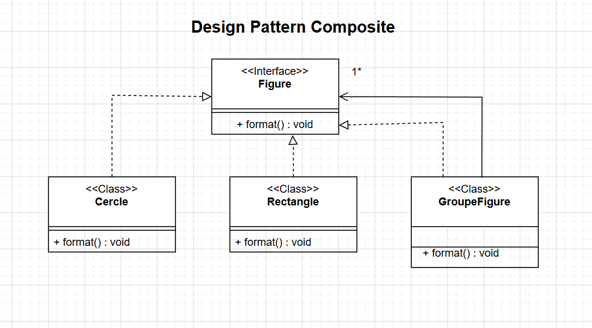
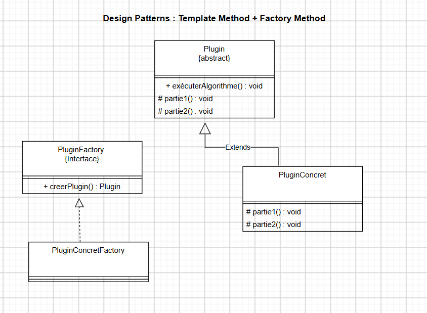
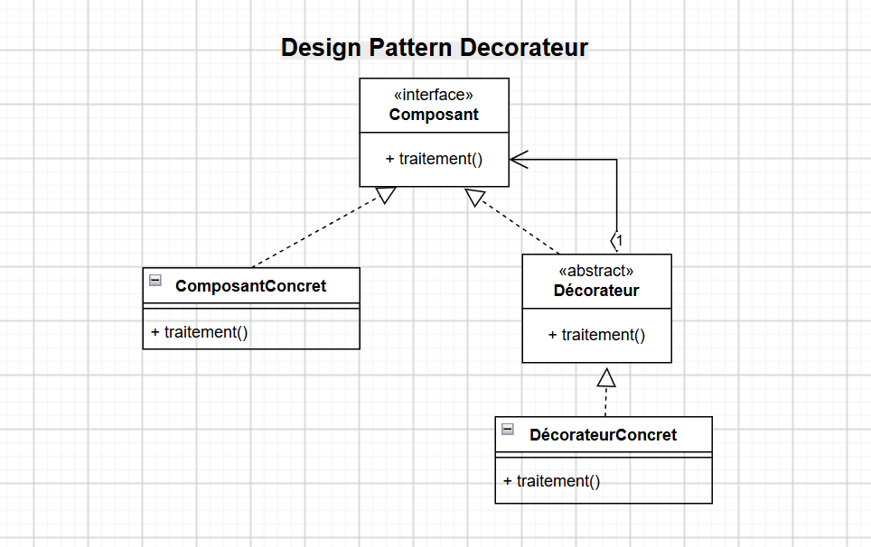
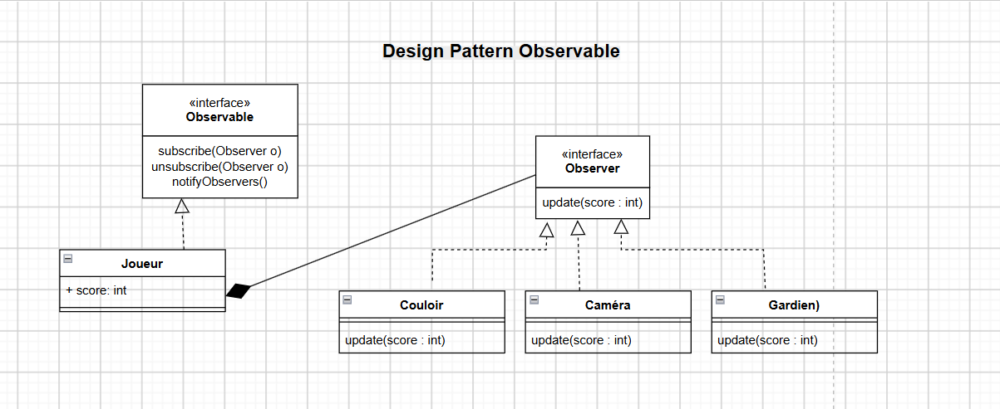
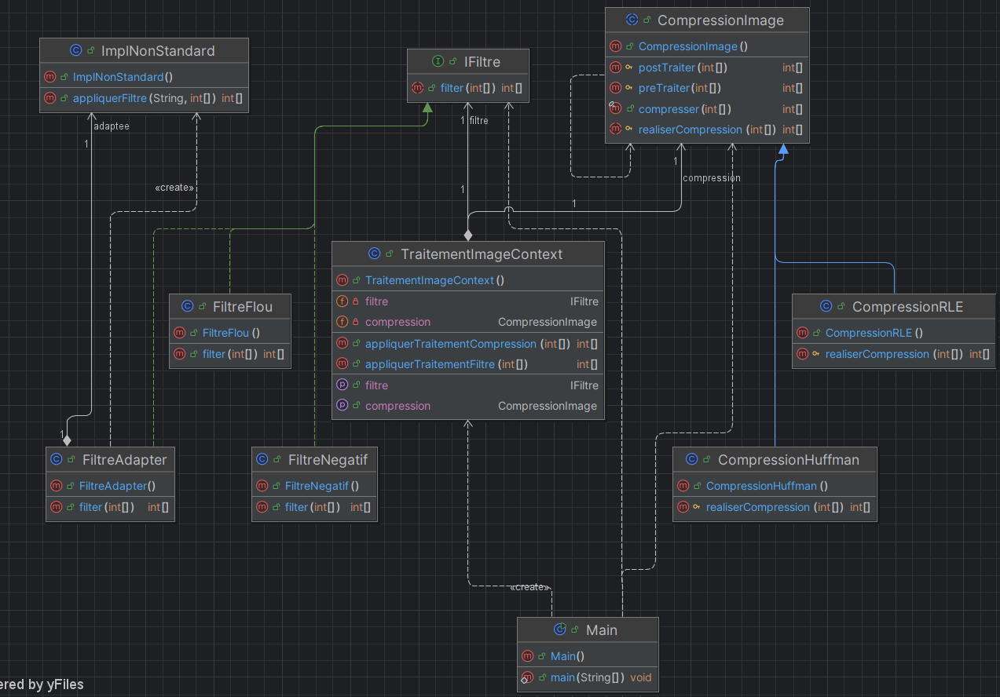

# TD N°1 – Design Patterns

Activité Pratique N°4 du module Design Patterns, encadrée par M. Mohamed Youssfi (filière GLSID 3, ENSET Mohammedia).

Ce travail consiste à choisir et représenter les design patterns adaptés à quatre situations de conception (exercice 1), puis à concevoir et implémenter en Java un framework de traitement d'image respectant le principe ouvert/fermé (exercice 2).

## Sommaire

1. [Introduction et structure du projet](#1-introduction-et-structure-du-projet)
2. [Exercice 1 : Diagrammes de classes et design patterns](#2-exercice-1--diagrammes-de-classes-et-design-patterns)
   - [2.1. Composite](#21-composite--figures)
   - [2.2. Template Method et Factory Method](#22-template-method-et-factory-method--plugin)
   - [2.3. Décorateur](#23-décorateur--traitement)
   - [2.4. Observer](#24-observer--joueur)
3. [Exercice 2 : Framework de traitement d'image](#3-exercice-2--framework-de-traitement-dimage)
   - [3.1. Analyse des besoins](#31-analyse-des-besoins)
   - [3.2. Diagramme de classes](#32-diagramme-de-classes)
   - [3.3. Implémentation Java](#33-implémentation-java)
   - [3.4. Application cliente](#34-application-cliente)
4. [Conclusion](#5-conclusion)

---

## 1. Introduction et structure du projet

### 1.1. Objectif

L'objectif est d'identifier les design patterns appropriés à une situation donnée, de les modéliser par des diagrammes de classes UML, puis de les mettre en oeuvre dans un framework Java extensible.

**Design patterns utilisés**

| Pattern | Catégorie | Utilisation |
|---|---|---|
| Composite | Structurel | Exercice 1 – Question 1 |
| Template Method | Comportemental | Exercice 1 – Question 2 ; Exercice 2 (compression) |
| Factory Method | Création | Exercice 1 – Question 2 |
| Décorateur | Structurel | Exercice 1 – Question 3 |
| Observer | Comportemental | Exercice 1 – Question 4 |
| Strategy | Comportemental | Exercice 2 (filtres) |
| Adapter | Structurel | Exercice 2 (ancienne implémentation) |

**Technologies**

| Domaine | Technologies |
|---|---|
| Langage | Java 11 ou supérieur |
| Modélisation | Diagrammes de classes UML (draw.io, IntelliJ IDEA / yFiles) |
| Outils | Maven ou javac, IntelliJ IDEA, Git / GitHub |

---

## 2. Exercice 1 : Diagrammes de classes et design patterns

### 2.1. Composite : Figures

**Énoncé.** Une figure peut être soit un cercle, soit un rectangle, soit un groupe de figures.

**Pattern retenu.** Composite : il permet de traiter de manière uniforme un objet simple (feuille) et un ensemble d'objets (composite).

*Figure 1 : Diagramme de classes du pattern Composite.*

| Rôle | Classe | Description |
|---|---|---|
| Component | `Figure` | Interface déclarant `format()` |
| Leaf | `Cercle`, `Rectangle` | Figures simples |
| Composite | `GroupeFigure` | Contient une collection (`1..*`) de `Figure` |

### 2.2. Template Method et Factory Method : Plugin

**Énoncé.** Un plugin contient une opération implémentant le squelette d'un algorithme dont deux parties (`partie1` et `partie2`) sont variables. Le développeur doit pouvoir implémenter ces deux parties, et l'application cliente doit pouvoir instancier une implémentation concrète du plugin sans connaître sa classe.

**Patterns retenus.**
- Template Method : l'opération fixe le squelette de l'algorithme et délègue `partie1` et `partie2` aux sous-classes.
- Factory Method : une fabrique crée l'instance concrète, le client ne manipule que les abstractions.

*Figure 2 : Diagramme de classes Template Method + Factory Method (plugin).*

| Rôle | Classe | Description |
|---|---|---|
| AbstractClass | `Plugin` | Méthode `operation()` finale, méthodes abstraites `partie1()` et `partie2()` |
| ConcreteClass | `PluginConcret` | Implémente `partie1()` et `partie2()` |
| Creator | `PluginFactory` | Interface déclarant `creerPlugin()` |
| ConcreteCreator | `PluginConcretFactory` | Retourne une instance de `PluginConcret` |

### 2.3. Décorateur : Traitement

**Énoncé.** Un composant implémente une interface définissant l'opération `traitement()`. On souhaite lui rattacher des responsabilités supplémentaires, exécutées avant et après `traitement()`, sans modifier son code source.

**Pattern retenu.** Décorateur : il enveloppe le composant et ajoute dynamiquement des comportements.

*Figure 3 : Diagramme de classes du pattern Décorateur.*

| Rôle | Classe | Description |
|---|---|---|
| Component | `Composant` | Interface déclarant `traitement()` |
| ConcreteComponent | `ComposantConcret` | Traitement de base |
| Decorator | `Décorateur` | Classe abstraite détenant un `Composant` |
| ConcreteDecorator | `DécorateurConcret` | Ajoute des traitements avant et après |

### 2.4. Observer : Joueur

**Énoncé.** La classe `Joueur` possède un état `score`. Les objets `Couloir`, `Caméra` et `Gardien` doivent être informés à chaque changement du score, avec un couplage faible entre `Joueur` et ces classes.

**Pattern retenu.** Observer (Observable / Observer).

*Figure 4 : Diagramme de classes du pattern Observable.*

| Rôle | Classe | Description |
|---|---|---|
| Subject | `Observable` | Interface : `subscribe`, `unsubscribe`, `notifyObservers` |
| ConcreteSubject | `Joueur` | Détient le `score` et la liste des observateurs |
| Observer | `Observer` | Interface déclarant `update(int score)` |
| ConcreteObserver | `Couloir`, `Caméra`, `Gardien` | Réagissent au changement de score |

---

## 3. Exercice 2 : Framework de traitement d'image

### 3.1. Analyse des besoins

Le framework traite une image représentée par un tableau d'entiers et définit deux opérations principales : `filter(int[] data)` et `compresser(int[] data)`.

| Exigence | Solution retenue |
|---|---|
| Fermé à la modification, ouvert à l'extension | Programmation par interfaces et classes abstraites |
| Filtre évolutif, nouvelles implémentations définies par l'utilisateur | Strategy : interface `IFiltre` |
| Changement dynamique du filtre à l'exécution | Contexte `TraitementImageContext` avec `setFiltre(...)` |
| Réutilisation de l'ancienne `ImplNonStandard` (`appliquerFiltre(String, int[])`) | Adapter : `FiltreAdapter` |
| Squelette de la compression, détails délégués aux sous-classes | Template Method : `CompressionImage` |

### 3.2. Diagramme de classes

*Figure 5 : Diagramme de classes du framework de traitement d'image.*

| Classe / Interface | Rôle | Pattern |
|---|---|---|
| `IFiltre` | Contrat `filter(int[])` | Strategy |
| `FiltreFlou`, `FiltreNegatif` | Filtres concrets | Strategy |
| `ImplNonStandard` | Ancienne implémentation à réutiliser | Adaptee |
| `FiltreAdapter` | Adapte `ImplNonStandard` à `IFiltre` | Adapter |
| `CompressionImage` | Squelette : `preTraiter`, `realiserCompression`, `postTraiter` | Template Method |
| `CompressionRLE`, `CompressionHuffman` | Implémentent `realiserCompression` | Template Method |
| `TraitementImageContext` | Détient le filtre et la compression courants | Context |
| `Main` | Application cliente | – |

---

## 5. Conclusion

Ce TD a permis d'appliquer sept design patterns et d'observer leur complémentarité :

- Strategy et Adapter offrent des filtres interchangeables à l'exécution, y compris une ancienne implémentation non conforme.
- Template Method garantit un algorithme de compression stable dont seules les étapes spécifiques varient.
- Le framework respecte le principe ouvert/fermé : ajouter un filtre ou une compression ne nécessite aucune modification du code existant.

---

**Réalisé par :** Fatima AITOULAHYAN, ENSET Mohammedia, GLSID 3
**Encadrant :** M. Mohamed YOUSSFI
